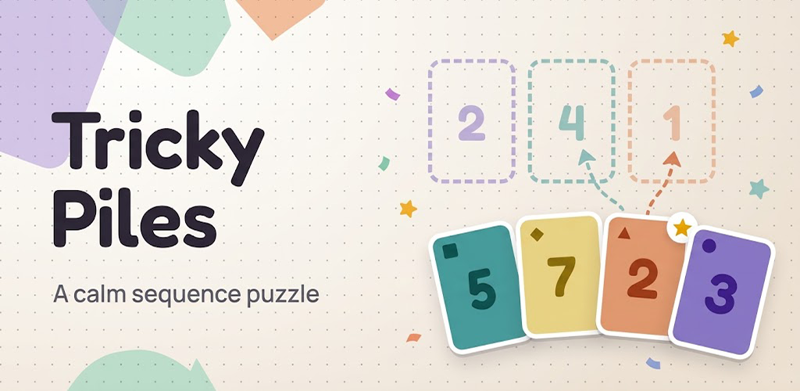
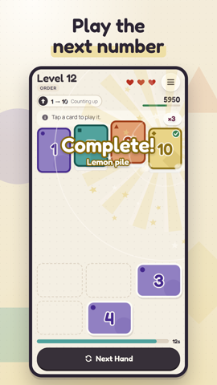
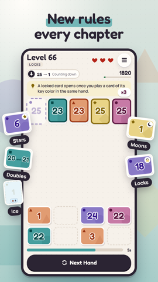
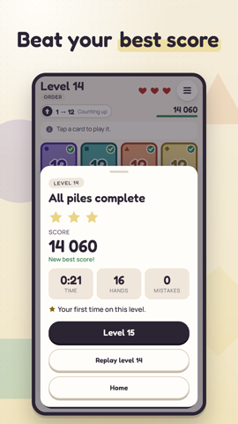
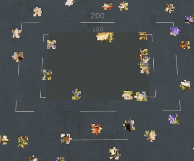
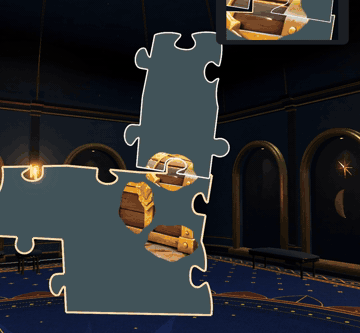
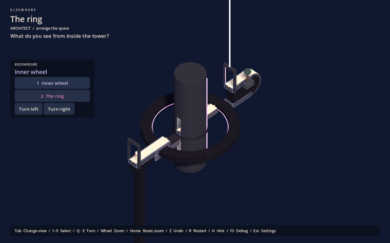
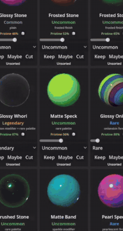

# Hi, I'm Daniel Inverno

3D artist and game developer based near Rotterdam, Netherlands. I spent years in professional 3D production: as Lead 3D Artist at Ad-pulse I built the company's 3D department from scratch, and at Platforme I produced 3D content for Gucci, Hermès and Dior. Today I design and ship my own games and apps, from the first prototype to the store page, using Godot, TypeScript and AI coding agents.

🏆 Best Overall Art Direction, *Clocktergeist*, Boss Rush Jam 2025

## Released

### Tricky Piles: Sequence Game · [Google Play](https://play.google.com/store/apps/details?id=com.daninverno.trickypiles)

A calm card-sequence puzzle for Android. I built it solo and took it from prototype to a live store release.

- **Stack:** TypeScript, Vite, Capacitor 8, with a PixiJS effects layer over an accessible DOM board
- **Product:** rewarded ads (AdMob with consent), a Remove Ads purchase (Play Billing), online rankings (Supabase), daily streaks, boss levels and music
- **Reach:** localised into English, Portuguese, Dutch, Korean and Simplified Chinese
- **Quality:** deterministic level generator guarded by thousands of unit, oracle and golden tests, Playwright end-to-end tests, and database tests in CI

  

## In development

### Jigsaw · Steam demo coming soon

 

A first-person 3D jigsaw game in Godot 4.7 (Forward+, Jolt). You solve puzzles of up to 2,000 pieces in a celestial atelier that I modelled in Blender and textured in Substance Designer. Progress lives in the room itself: unplayed puzzles wait as boxes, finished ones hang framed on the walls, and you can replay your whole build afterwards. Act One, with its tools, charms and objectives, is the upcoming Steam demo.

## Prototypes

I prototype fast to find the fun, then keep only what earns its place.

| | |
|---|---|
|  | **[Elsewhere](https://github.com/wynterCG/spatial-puzzle-adventure)** · Godot 4.7 First-person architectural puzzle adventure. Gravity follows authored paths around walls and undersides, and you reshape the monument from an isometric view. Includes an editor dock for authoring, validating and play-testing levels. |
|  | **[GRIP UP](https://github.com/wynterCG/grip_up)** · Godot 4.7, Jolt Physics climbing lab: each mouse button is a hand, with finite arm tension, swings and charged launches. Paired with an offline auto-tuning lab (Python, Optuna) that compares controller parameters. |
|  | **[Stridekeep](https://github.com/wynterCG/stridekeep-legacy)** · React Native, Expo, Supabase Team walking game for Android: real steps from Health Connect unlock tiles, and two teams race to paint a shared pixel-art mural with realtime updates. |
|  | **MarbleKeep** · Godot 4.6 Always-on-top desktop toy with a physics marble, plus a procedural marble generator and curation tool built for it. |

Other experiments: an AI-judged debate web app ([Witclash](https://github.com/wynterCG/witclash), Next.js + Claude), GPU cellular automata, a deck-driven tower defense roguelike, rigid-body puzzles and a [Breakout roguelike](https://github.com/wynterCG/BreakoutRoguelike).

## Tools

- **3D and art:** Blender, Maya, Substance Painter and Designer, Photoshop, Illustrator
- **Games:** Godot 4 (GDScript), Jolt physics, Unreal Engine basics
- **Apps and web:** TypeScript, React, Vite, Next.js, Capacitor, Supabase (Postgres, RLS, realtime)
- **AI workflow:** Claude Code and other coding agents, with written specs, tests and code review on every change

## Contact

- Portfolio: [daninverno.com](https://daninverno.com)
- Email: winterpt91@gmail.com
